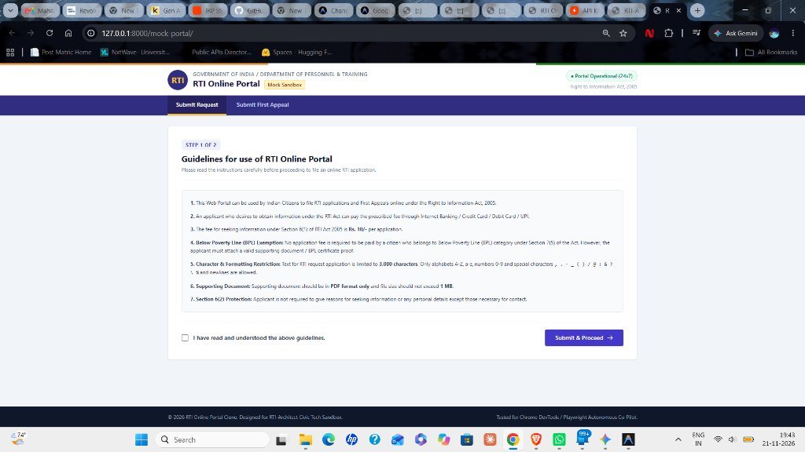
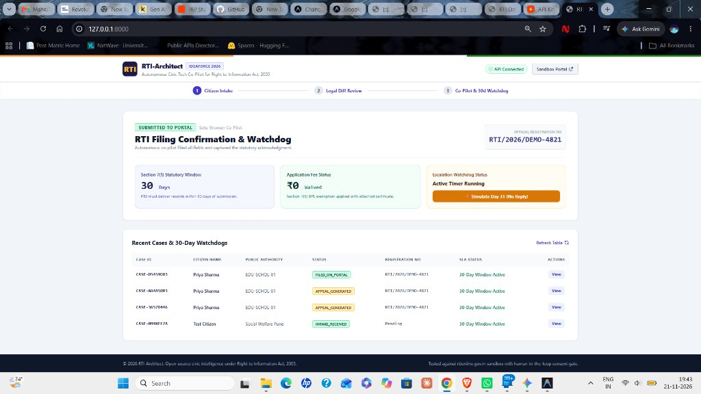
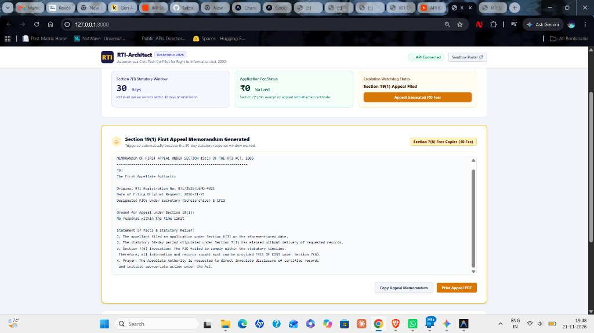

# NyayaSetu — AI-Powered Civic Accountability & Statutory Co-Pilot

> **NxtWave IdeaForce Online Hackathon · Track 1: Civic Pulse, Digital Governance & Public Information**

**Live Deployment:** (https://nyayasetu-t3e1.onrender.com/)`  
**Demo Video:** `[Add your 3-minute walkthrough video link here](https://your-demo-video-url.com)`

---

## Why `NyayaSetu` Was Made

Under India's [Right to Information (RTI) Act, 2005](https://egovernance.vikaspedia.in/viewcontent/e-governance/about-rti-act-2005/how-to-file-an-rti-application-online-and-offline?lgn=en), every citizen has the legal right to demand government records—without hiring a lawyer or giving a reason ([Section 6(2)](https://www.legalrepublic.in/everyday-law/templates/rti-application/)). Yet millions of citizen applications stall or get rejected for four avoidable reasons:

1. **Invalid Question Framing:** Citizens naturally ask *"Why was my scholarship/work delayed?"*—which Public Information Officers (PIOs) reject because the Act only covers existing records and file notings under [Section 6(1)](https://www.legalrepublic.in/everyday-law/templates/rti-application/).
2. **Wrong Authority Routing:** Applications sent to a central ministry instead of the record-holding field office bounce under [Section 6(3)](https://egovernance.vikaspedia.in/viewcontent/e-governance/about-rti-act-2005/how-to-file-an-rti-application-online-and-offline?lgn=en).
3. **Portal & Formatting Friction:** [rtionline.gov.in](https://rtionline.gov.in/guidelines.php?request) enforces a strict 3,000-character limit, an ASCII-only character whitelist, PDF-only attachments (<= 1 MB), and complex BPL fee-exemption rules ([Section 7(5)](https://egovernance.vikaspedia.in/viewcontent/e-governance/about-rti-act-2005/rti-fees-and-payment-modes?lgn=en)).
4. **Missed Escalations:** Citizens rarely track the 30-day statutory deadline ([Section 7(1)](https://egovernance.vikaspedia.in/viewcontent/e-governance/about-rti-act-2005/how-to-file-an-rti-application-online-and-offline?lgn=en)) or file a ₹0 [Section 19(1)](https://www.legalrepublic.in/everyday-law/templates/rti-application/) First Appeal claiming free copies under [Section 7(6)](https://egovernance.vikaspedia.in/viewcontent/e-governance/about-rti-act-2005/rti-fees-and-payment-modes?lgn=en).

---

## What `NyayaSetu` Does

1. **Multimodal Citizen Intake:** Citizens speak in Hindi, Marathi, or English and upload a photo of any stamped receipt or rejection slip.
2. **Legal Reframing & Authority Matching:** AI extracts reference IDs, maps the exact PIO, converts emotional complaints into factual Section 6(1) record requests, and reads back a plain-language audio summary.
3. **Consent-Gated Co-Browsing:** A live Playwright co-pilot fills the portal form, uploads the auto-compressed `<= 1 MB` PDF, and **pauses at the CAPTCHA/Payment gate** for human review and submission.
4. **30-Day Statutory Watchdog & Formal Print:** Tracks the 30-day SLA, exports clean A4 legal Acknowledgments and First Appeals, and auto-drafts Section 19(1) Appeals invoking Section 7(6) free-copy penalties on Day 31.

---

## Multi-Agent AI Architecture (100% Open-Source Stack)

| Agent | Role | Open-Source Model / Tooling |
| :--- | :--- | :--- |
| **`Vaani-ASR`** | Live regional voice transcription & plain-language summary readback | `whisper-large-v3-turbo` + Browser SpeechSynthesis (compatible with [AI4Bharat IndicConformer](https://github.com/AI4Bharat/IndicConformerASR)) |
| **`Drishti-Doc`** | Extracts App ID, dates, and office stamps from receipt photos + compresses to `<= 1 MB` PDF | Open-weight Llama Vision + `Pillow` |
| **`Adhikar-RAG`** | Maps grievances to the exact Central/State Public Authority, PIO, and SLA | `ChromaDB` (local ONNX embeddings) |
| **`Nyaya-Draft`** | Converts *"why"* complaints into 4 factual Section 6(1) record requests (`<= 3000` ASCII chars) | `llama-3.1-8b-instant` / `qwen2.5:7b` + deterministic Python guardrails |
| **`Setu-Browser`** | Live Playwright co-pilot that fills forms and pauses for human consent | `Playwright` (Chromium, `headless=False`) |
| **`Prahari-Watch`** | Tracks the 30-day statutory clock and generates Section 19(1) + 7(6) First Appeals | Python + `SQLite` + Formal A4 Document Print |

---

## Human-in-the-Loop Consent & Legal Safety

* **Zero CAPTCHA Bypassing / Zero Password Storage:** `Setu-Browser` hard-pauses (`PAUSED_FOR_HUMAN_CONSENT`) before submission so the citizen personally reviews the preview, enters the Security Code, and confirms payment/submission.
* **No LLM-Invented Law:** All statutory citations (`Sections 6(1), 6(2), 6(3), 7(1), 7(5), 7(6), 19(1)`) are injected from verified static templates—never generated from LLM memory.
* **Authenticated Citizen Workspace:** User accounts isolate each citizen's drafts, receipts, and 30-day timers.

---

## Screenshots

| 1. Live Playwright Co-Pilot & Portal Sandbox | 2. RTI Filing Confirmation & 30-Day Watchdog Dashboard |
| :---: | :---: |
|  |  |

| 3. Day 31 Statutory First Appeal (Section 19(1) + Section 7(6) ₹0 Fee) |
| :---: |
|  |

---

## Quick Local Setup (Windows PowerShell)

```powershell
# 1. Clone & activate virtual environment
git clone https://github.com/<your-username>/nyayasetu-rti-architect.git
cd nyayasetu-rti-architect
py -m venv .venv
.\.venv\Scripts\Activate.ps1

# 2. Install dependencies & Playwright Chromium
python -m pip install --no-cache-dir fastapi uvicorn pydantic chromadb playwright python-multipart httpx python-dotenv pillow
python -m playwright install chromium

# 3. Configure .env (use free Groq API key or local Ollama)
# LLM_PROVIDER=groq
# GROQ_API_KEY=your_key_here
# LLM_MODEL=llama-3.1-8b-instant

# 4. Run unified app + mock RTI portal
python -m uvicorn backend.main:app --host 127.0.0.1 --port 8000
```

Open **`http://127.0.0.1:8000`** in Chrome.
